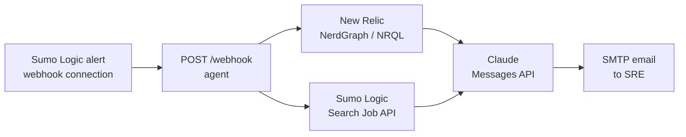
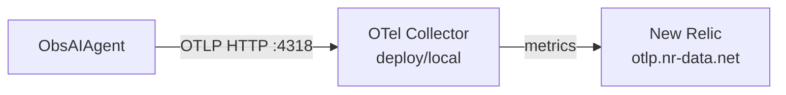

# ObservabilityAgentAI

An AI-powered observability agent written in Go. When a Sumo Logic alert fires, the agent reads the alert (app and time window), pulls metrics and slow traces from **New Relic** and logs from **Sumo Logic** for that app and window, asks Claude to identify the likely issue and recommendations, and emails the result to the SRE.

> **Status: proof of concept.** The full alert-to-email path is implemented and has run against live New Relic and Claude accounts. Sumo Logic search is being verified. See [Roadmap](#roadmap) and [Known Issues](#known-issues).

## The Problem

During an incident, SREs switch between Sumo Logic (logs) and New Relic (metrics and traces), manually correlating timestamps, trace IDs and service names. The agent does that first pass automatically, so the SRE starts with a summary instead of a blank search.

## How It Works

1. **Sumo Logic alert fires.** A webhook connection posts JSON to the agent's `/webhook` endpoint, with the app name and the alert time window.
2. **Agent validates and accepts.** The request must carry the `X-Webhook-Secret` header. The service name is checked, duplicates are ignored, and the work runs in the background (the endpoint returns `202`).
3. **New Relic.** The agent runs NRQL through NerdGraph for the app's request count, error percentage and duration, and for its slowest transactions with their trace IDs.
4. **Sumo Logic.** The agent runs a search job for the app's log lines in the same window and collects up to 200 lines, oldest first.
5. **Claude.** The alert, metrics, traces and logs go to the Anthropic Messages API. The reply is parsed into a summary, probable root cause, confidence, evidence and recommended actions.
6. **Email.** The analysis is sent as plain text over SMTP. With `--dry-run` it is printed to the console instead.



Logs and metrics already reach Sumo Logic and New Relic through your existing pipelines. The agent reads from those platforms. OpenTelemetry is used only to send the agent's own latency metrics to New Relic, see [Latency Metrics](#latency-metrics).

## Current Status

| Component | Location | Status |
|---|---|---|
| Entrypoint, `/webhook`, `/healthz` | `cmd/main.go` | Done |
| Config loader and validation | `config/config.go` | Done |
| Alert handling (auth, validation, de-duplication) | `internal/webhook/` | Done |
| New Relic metrics and slow traces | `internal/newrelic/` | Done. Verified against a live account |
| Sumo Logic search jobs and normalisation | `internal/sumologic/` | Done. Query is being verified against live logs |
| Claude analysis | `internal/reasoner/` | Done. Verified against a live run |
| Email report | `internal/output/` | Done |
| Pipeline orchestration | `internal/pipeline/` | Done |
| Correlation by trace ID | — | Not started. Events are sorted by time and sent as they are |
| Slack / PagerDuty output | — | Not started |
| Latency metrics (OpenTelemetry to New Relic) | `internal/telemetry/` | Done. Off by default, see [Latency Metrics](#latency-metrics) |

## Latency Metrics

The agent can send timing metrics for each step of an alert run to New Relic, through the OpenTelemetry Collector in `deploy/local/`. Use them to see where the time goes: New Relic queries, Sumo Logic search, the Claude call, or the whole run.

| Metric | Unit | Attributes | Measures |
|---|---|---|---|
| `newrelic.query.duration` | s | `query`: `metrics` or `traces` | One NRQL query through NerdGraph |
| `sumo.query.duration` | s | — | One Sumo Logic search job, including the polling wait |
| `llm.query.duration` | s | — | One Claude request |
| `agent.run.duration` | s | — | One full alert run, from start to email or print |

These metrics are recorded only when an alert runs through the pipeline. Sending a test webhook is enough to produce them.



**Setup**

1. In the root `.env`, set `OTEL_ENABLED=true` and `OTEL_ENDPOINT=http://localhost:4318`.
2. Set `NEW_RELIC_LICENSE_KEY` and `SUMO_HTTP_SOURCE_URL` in the root `.env`. The collector reads them through `env_file` in `deploy/local/docker-compose.yml`. Use the New Relic ingest license key, not the User API key. The collector won't start without `SUMO_HTTP_SOURCE_URL`, even though the agent doesn't send logs through that pipeline.
3. Start the Collector:
   ```bash
   cd deploy/local
   docker compose up -d
   ```
   On a network that inspects HTTPS traffic, mount your host's CA bundle into the collector so it trusts New Relic's certificate. See the `volumes` entry in `docker-compose.yml`.
4. Run an alert. Then query the metrics in New Relic:
   ```
   FROM Metric SELECT average(newrelic.query.duration) FACET query TIMESERIES SINCE 1 hour ago
   ```

Metrics are sent about once a minute, and again when the agent exits. For a short test, stop the agent with Ctrl+C so the last batch is sent. To see the metrics locally without New Relic, run `docker logs otel-collector`.

## Project Structure

```
.
├── cmd/
│   └── main.go                       # entrypoint
├── config/
│   └── config.go                     # environment-based config loader
├── deploy/
│   └── local/                        # OTel Collector and docker-compose
├── internal/
│   ├── newrelic/                     # New Relic NerdGraph client
│   │   ├── client.go
│   │   ├── model.go
│   │   └── query.go                  # NRQL helpers: metrics, slow traces
│   ├── sumologic/                    # Sumo Logic Search Job API client
│   │   ├── client.go
│   │   ├── model.go
│   │   ├── normalize.go
│   │   └── search.go
│   ├── reasoner/                     # Claude client, prompt building, redaction
│   ├── output/                       # SMTP mailer and report rendering
│   ├── pipeline/                     # runs one alert end to end
│   ├── webhook/
│   │   └── handler.go                # Sumo alert receiver
│   └── telemetry/                    # optional OpenTelemetry setup (off by default)
├── pkg/
│   └── models/
│       ├── alerts.go                 # inbound alert payload
│       └── events.go                 # normalised Event type
├── go.mod
└── go.sum
```

## Getting Started

### Prerequisites

- Go 1.25.5 (as declared in `go.mod`)
- A Sumo Logic access ID and key with Search Job API access, and an alert that can call a webhook
- A New Relic **User API key** (for NerdGraph), your account ID, and an **ingest license key** (for the collector)
- An Anthropic API key
- An SMTP account for sending email (Gmail needs an app password). Some networks block outbound port 587

### Configuration

Create a `.env` file in the repo root with the variables below. Do not commit it.

| Variable | Required | Default | Purpose |
|---|---|---|---|
| `WEBHOOK_SECRET` | yes | — | Shared secret Sumo sends in the `X-Webhook-Secret` header |
| `ANTHROPIC_API_KEY` | yes | — | Claude API key |
| `ANTHROPIC_MODEL` | no | `claude-sonnet-5-5` | Model used for the analysis |
| `SUMOLOGIC_ACCESSID_SANDBOX` | yes | — | Sumo Logic access ID |
| `SUMOLOGIC_ACCESSKEY_SANDBOX` | yes | — | Sumo Logic access key |
| `SUMOLOGIC_ENDPOINT` | no | `https://api.sumologic.com/api/v1` | Use your deployment, e.g. `https://api.au.sumologic.com/api/v1` for Australia |
| `SUMO_SERVICE_FIELD` | no | `service` | Log field that holds the app name |
| `SUMO_HTTP_SOURCE_URL` | yes for the collector | — | Sumo HTTP source URL, used by `deploy/local` |
| `NEWRELIC_APIKEY_SANDBOX` | yes | — | New Relic **User API key** (not the ingest licence key) |
| `NEWRELIC_ACCOUNTID_SANDBOX` | yes | — | New Relic account ID |
| `NEW_RELIC_LICENSE_KEY` | for the collector | — | New Relic **ingest** license key, used by `deploy/local` |
| `QUERY_WINDOW` | no | `15m` | Look-back used when the alert has no window |
| `DRY_RUN` | no | `false` | Print the report instead of emailing it |
| `EMAIL_TO` | yes unless dry run | — | Recipient(s), comma separated |
| `EMAIL_FROM` | yes unless dry run | `SMTP_USERNAME` | Sender address |
| `SMTP_HOST` | no | `smtp.gmail.com` | SMTP relay |
| `SMTP_PORT` | no | `587` | SMTP port (STARTTLS) |
| `SMTP_USERNAME`, `SMTP_PASSWORD` | no | — | SMTP credentials, if the relay needs them |
| `WEBHOOK_PORT` | no | `8080` | Port for the webhook server |
| `SERVICE_NAME`, `ENVIRONMENT` | no | `ObsAIAgent`, `dev` | Labels for the agent |
| `OTEL_ENABLED`, `OTEL_ENDPOINT` | no | `false`, `http://localhost:4318` | Send latency metrics to the OTel Collector. See [Latency Metrics](#latency-metrics) |

The agent does not load `.env` by itself. Export the variables first:

```bash
set -a; source .env; set +a
```

### Build and Run

```bash
go build -o obsaiagent ./cmd
./obsaiagent --dry-run     # print reports to the console
./obsaiagent               # send reports by email
```

### Configure the Sumo Logic Alert

Create a webhook connection in Sumo Logic that POSTs to `https://<agent-host>/webhook`, and attach it to the alert. Add the header `X-Webhook-Secret` with the value of `WEBHOOK_SECRET`. Sumo's webhook connection must support custom headers.

The JSON payload should include:

- `id`: the alert ID, used to avoid duplicate runs
- `name`: the alert name
- `service`: the app name as it appears in New Relic and in the logs. Letters, digits, `.`, `_` and `-` only
- `timestamp`: when the alert fired, in RFC 3339 (for example `2026-11-25T10:00:00Z`)
- `window_start` and `window_end` (optional): the time range to analyse, in RFC 3339
- `severity` and `message` (optional): shown in the report

The agent must be reachable from Sumo's cloud, so it needs a public HTTPS endpoint or a tunnel.

## Roadmap

| Phase | Status | Description |
|---|---|---|
| 1 | Done | Data clients: Sumo Logic and New Relic |
| 2 | Done | Alert webhook: authentication, validation, de-duplication, background pipeline |
| 3 | Done | Analysis and delivery: Claude summary, email report, dry-run mode |
| 4 | Partly done | Live testing: New Relic and Claude verified. Sumo Logic search and email delivery still to be confirmed |
| 5 | Pending | Correlator: group logs and traces by trace ID and time |
| 6 | Pending | Slack or PagerDuty output |
| 7 | Partly done | OpenTelemetry: latency metrics are in place (see [Latency Metrics](#latency-metrics)). Agent traces are not yet added |
| 8 | Stretch | Incident history and feedback loop |

## Known Issues

- **Sumo query is not general yet.** The search is being tested against one source category and a JSON `service` field. It should be made configurable per app before wider use.
- **Port 465 (implicit TLS) is not supported.** `SMTP_PORT` must be a STARTTLS port such as 587.
- **No retries on Sumo or New Relic.** A transient error becomes a warning in the report.
- **Concurrency is unbounded.** Each alert starts its own goroutine. Add a limit before running many alerts at once.
- **Build not run on the full module set.** Run `go build ./...` and `go test ./...` on a machine with module access.
- **Dependency on OpenTelemetry packages.** `internal/telemetry` still imports the OTel modules. They are only used when `OTEL_ENABLED=true`.